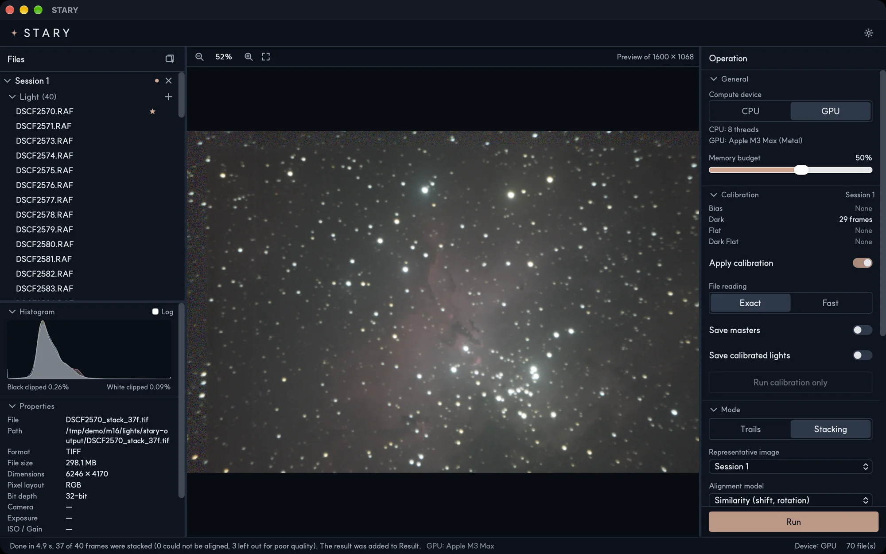

<p align="center">
  
</p>

<p align="center">
  <a href="https://stary.readthedocs.io/"></a>
  <a href="https://domiki.github.io/STARY/"></a>
  <a href="https://github.com/Domiki/STARY/releases"></a>
  <a href="https://github.com/Domiki/STARY/releases"></a>
  
  <a href="LICENSE"></a>
  <a href="https://buymeacoffee.com/domiki"></a>
</p>

STARY calibrates, aligns and stacks night-sky photographs. Reduce the noise of deep-sky images, or let the
stars draw their trails, with the heavy lifting done on your GPU. It runs on macOS (Apple silicon) and Windows.

> **Version 0.1.0 (pre-release).** STARY is young: some features are experimental and Linux is not supported yet.

<p align="center">
  
</p>

## Features

- **Deep-sky stacking** — star alignment, brightness normalization and sigma-clipping rejection of satellites
  and airplanes. Poor frames (clouds, blur, trailed stars) are left out and marked for you.
- **Star trails** — Lighten, a fading Comet mode, and Gap Filling that joins dotted trails.
- **Calibration on raw data** — Dark, Flat, Dark Flat and Bias frames, or ready-made masters, one set per session.
- **Ground masking** — automatic sky detection with a brush to refine it; the sky and the ground are
  processed apart so the landscape stays sharp.
- **Several sessions** — stack many nights together; an experimental HDR merge joins different exposures.
- **GPU acceleration** — Metal, DirectX 12 and Vulkan (through [wgpu](https://wgpu.rs)).
- **Faithful output** — results are saved as 32-bit float TIFF; *Save as…* exports TIFF, PNG, JPEG and FITS in
  sRGB, Display P3 or Adobe RGB with the profile embedded.
- **Many inputs** — camera RAW (via LibRaw), FITS, JPEG, PNG and TIFF.

## Download

Get the installer for your system from the [latest release](https://github.com/Domiki/STARY/releases):

| System | File |
|---|---|
| macOS, Apple silicon (M1 or later) | `.dmg` |
| Windows 10 / 11, 64-bit | installer |

Pre-release builds are not signed with a paid developer certificate, so the system warns you the first time:

- **macOS** — right-click the app and choose **Open** (or *System Settings → Privacy & Security → Open Anyway*).
  If it says the app is damaged, run `xattr -cr /Applications/STARY.app`.
- **Windows** — in SmartScreen choose **More info → Run anyway**.

## Quick start

1. Drop your **Light** frames (and Dark, Flat, Dark Flat and Bias frames, if you have them) into a session.
2. Choose **Trails** (star trails) or **Stacking** (deep sky) in the Mode section.
3. Press **Run**. The result is saved next to your first file, in a `stary-output` folder.

## Documentation

- **Manual** (English, 한국어): <https://stary.readthedocs.io/> — a user guide and notes on how it works.
- **Website**: <https://domiki.github.io/STARY/> — downloads, FAQ and news.

The manual is written in Markdown under [`docs/`](docs) and built with [MkDocs](https://www.mkdocs.org).

## Build from source

You need [Rust](https://rustup.rs) (the version is pinned in `rust-toolchain.toml`) and
[Node.js](https://nodejs.org).

```sh
git clone https://github.com/Domiki/STARY.git
cd STARY
npm install
npm --prefix ui install

npx tauri dev      # run the app in development
npx tauri build    # build the installers (target/release/bundle)
```

On Windows you also need the Visual Studio Build Tools (C++ workload) and [LLVM](https://releases.llvm.org),
which compiles LibRaw (see `.cargo/config.toml`).

Checks:

```sh
cargo test --workspace
cargo clippy --workspace --all-targets
npm --prefix ui run typecheck
npm --prefix ui test
```

### Repository layout

| Path | What it holds |
|---|---|
| `src-tauri/` | The desktop application (Tauri): commands, job handling, window |
| `ui/` | The interface (React and TypeScript) |
| `crates/stary-pipeline` | Jobs: calibration, stacking, star trails, HDR merge |
| `crates/stary-calib`, `stary-register`, `stary-stack` | Calibration masters, star alignment, warping and rejection |
| `crates/stary-gpu` | GPU stacking (wgpu) |
| `crates/stary-sky`, `stary-mask` | Sky detection and mask shaping |
| `crates/stary-io`, `stary-raw`, `stary-demosaic`, `stary-color` | File formats, RAW reading, demosaicing, color management |
| `crates/stary-cli` | A command-line interface to the same pipeline |
| `docs/`, `site/` | The manual (Read the Docs) and the website (GitHub Pages) |
| `brand/` | The icon and the logo, with the scripts that draw them |

## Contributing

Bug reports and ideas are welcome on the [issue tracker](https://github.com/Domiki/STARY/issues). When you report
a problem, please include your system, the version of STARY, what you did and, if you can, an example file.

## Support

If STARY is useful to you, you can support its development:

<a href="https://buymeacoffee.com/domiki"></a>

## License

STARY is released under the [MIT License](LICENSE).

Made by Dohyeok Ahn ([Domiki](https://github.com/Domiki), <ado505050@gmail.com>).

It builds on [Tauri](https://tauri.app), [React](https://react.dev), [Rust](https://www.rust-lang.org),
[LibRaw](https://www.libraw.org) (used under the CDDL), [wgpu](https://wgpu.rs) and other open-source projects.
The typeface, [SUIT](https://sun.fo/suit) by Sun (SUNN), is under the SIL Open Font License 1.1 (see
[`font/LICENSE`](font/LICENSE)); its Hangul glyphs are based on
[Source Han Sans](https://github.com/adobe-fonts/source-han-sans). [Siril](https://siril.org) was a reference
while testing the stacking.

Thanks to AAA (Amateur Astronomy Association) — <https://our.snuaaa.net/>.
