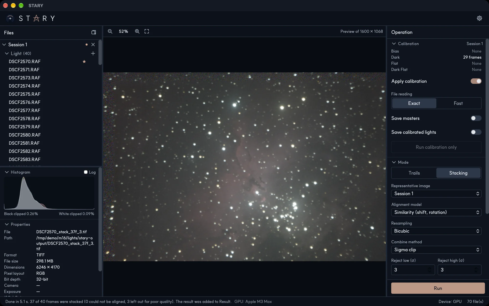

# Calibration

Calibration removes the faults of the sensor from your Light frames: the signal that builds up in the dark
(heat, amplifier glow) and the uneven lighting of the optics (vignetting, dust). It is optional but
makes stacks cleaner. See [how it works](../principles/calibration.md).

## What to prepare

Add calibration frames to the same session as the Lights they belong to:

- **Dark** — same exposure time and ISO (and about the same temperature) as the Lights.
- **Flat** — evenly lit frames taken with the same optics and focus as the Lights.
- **Dark Flat** — same exposure as the Flats, lens cap on. Alternatively **Bias** frames.
- **Bias** — shortest exposure, lens cap on.

You do not need all of them. A session with only Darks, or only Flats, is fine.

## The Calibration section

| Option | What it does |
|---|---|
| **Bias, Dark, Flat, Dark Flat** | Shows what the session holds for each role: *None*, *Master* or the number of frames. |
| **Apply calibration** | Calibrates the Lights with what the session holds. Off when the session has no calibration frames. |
| **File reading** | *Exact* reads each calibration file twice and rejects outliers precisely. *Fast* reads once and drops the largest and smallest values of every pixel; it helps on slow drives such as an external hard disk but rejects outliers less well. |
| **Save masters** | Writes the combined master frames (`master_dark.fits` and so on) to a folder, `stary-output/masters` by default. |
| **Save calibrated lights** | Writes every calibrated Light as a 16-bit FITS file to `stary-output/calibrated`. The size to be written is shown. |
| **Run calibration only** | Calibrates and saves without stacking. Turn on a save option first. |

Calibration happens automatically before stacking or trails when **Apply calibration** is on. With several
sessions, each session is calibrated with its own frames; a session without calibration frames is used as it is.

!!! tip "JPEG and PNG"
    Calibration needs the raw values of the sensor. With JPEG or PNG files it works, but less accurately, and
    STARY shows a warning on those files.
