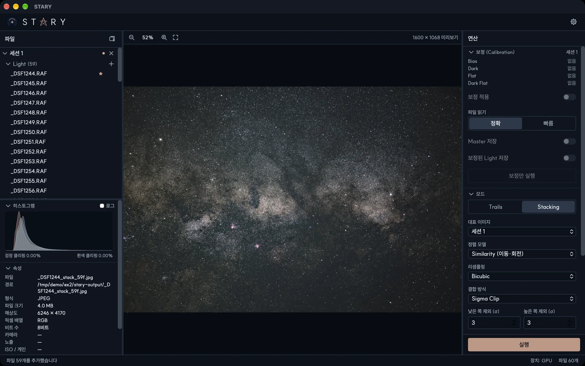

# 보정

보정은 Light 프레임에서 센서의 결함을 없앱니다. 어둠 속에서 쌓이는 신호(열, 앰프 글로우)와 광학계의 불균일한
밝기(비네팅, 먼지)입니다. 필수는 아니지만 스택이 더 깨끗해집니다. [처리 원리](../principles/calibration.md)를
참고하세요.

## 준비할 것

보정 프레임을 해당 Light와 같은 세션에 추가하세요.

- **Dark** — Light와 같은 노출 시간과 ISO(온도도 비슷하게)로 찍은 것
- **Flat** — Light와 같은 광학계와 초점으로 균일하게 밝힌 면을 찍은 것
- **Dark Flat** — Flat과 같은 노출로 렌즈 캡을 닫고 찍은 것. 대신 **Bias**를 써도 됩니다.
- **Bias** — 렌즈 캡을 닫고 가장 짧은 노출로 찍은 것

전부 있을 필요는 없습니다. Dark만 있거나 Flat만 있는 세션도 괜찮습니다.

## 보정 섹션

| 옵션 | 동작 |
|---|---|
| **Bias, Dark, Flat, Dark Flat** | 세션이 각 역할에 가진 것을 보여 줍니다. *없음*, *Master*, 또는 프레임 수 |
| **보정 적용** | 세션이 가진 보정 프레임으로 Light를 보정합니다. 보정 프레임이 없는 세션에서는 꺼져 있습니다. |
| **파일 읽기** | *정확*은 보정 파일을 두 번 읽어 이상값을 정밀하게 제거합니다. *빠름*은 한 번만 읽고 화소마다 가장 큰 값과 가장 작은 값 몇 개를 빼 버립니다. 외장하드처럼 읽기가 느릴 때 유리하지만 이상값 제거는 덜 정밀합니다. |
| **Master 저장** | 합친 master 프레임(`master_dark.fits` 등)을 폴더에 저장합니다. 기본은 `stary-output/masters`입니다. |
| **보정된 Light 저장** | 보정한 Light를 16비트 FITS로 `stary-output/calibrated`에 저장합니다. 저장될 크기가 표시됩니다. |
| **보정만 실행** | 스태킹 없이 보정하고 저장만 합니다. 먼저 저장 옵션을 켜야 합니다. |

**보정 적용**이 켜져 있으면 스태킹이나 궤적 합성 전에 자동으로 보정합니다. 세션이 여러 개면 각 세션이 자기
프레임으로 보정되고, 보정 프레임이 없는 세션은 그대로 쓰입니다.

!!! tip "JPEG와 PNG"
    보정에는 센서의 원본 값이 필요합니다. JPEG나 PNG에서도 동작하지만 정확도가 낮고, 해당 파일에 경고가
    표시됩니다.
