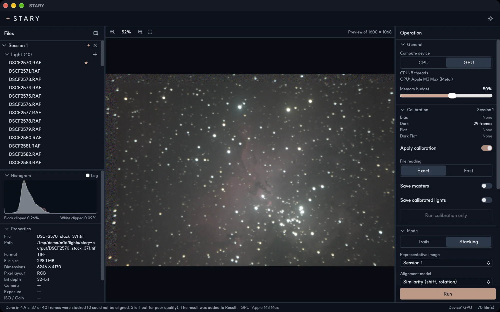

# Deep-sky stacking

Choose **Stacking** in the Mode section to make a deep-sky image. STARY finds the stars of every frame,
aligns the frames on the representative image, brings them to the same brightness and combines them with
outlier rejection. See [how it works](../principles/alignment.md).

## Options

| Option | What it does |
|---|---|
| **Representative image** | The session whose representative image is the alignment reference. The result has its size, and its sky mask and ground are used. Defaults to the active session. |
| **Alignment model** | *Similarity* (shift and rotation, the default), *Affine* or *Homography* for lenses with distortion or very wide fields. |
| **Resampling** | How frames are moved onto the reference: *Bilinear*, *Bicubic* (default) or *Lanczos-3* (sharpest). |
| **Combine method** | *Average* keeps everything. *Sigma clip* rejects values that are far from the mean: *Reject low (σ)* and *Reject high (σ)* set the limits (3 and 3 by default). |
| **HDR merge** | See below. Enabled only when the sessions hold more than one exposure. |
| **Skip poor frames** | Leaves out frames that are much worse than the rest of their session (clouds, haze, blur, trailed stars, too few stars, high noise). They get a **Left out** badge. |
| **Ground masking** | See [Ground masking](ground-masking.md). |
| **Demosaic quality** | *Fast* or *High*. |

Press **Run**. The result is named like `DSCF2570_stack_37f.tif`. The status bar tells how many frames
were stacked, how many could not be aligned and how many were left out for quality.

## Several sessions { #several-sessions }

Every session with Light frames is stacked **together**, so you can combine several nights. Each session
is calibrated with its own Dark, Flat and Bias frames, then all frames are aligned on the representative
image chosen under **Representative image**.

- A session whose frames differ in size or pixel layout from the reference session is not included.
- Poor frames are judged inside each session, because the sky is brighter on some nights than on others.
- The mask and the ground (if you stack the ground separately) come from the reference session only.
- Exposures may differ; each frame is brought to the brightness of the reference, but they are weighted equally.

## HDR merge { #hdr }

Bright stars and nebula cores saturate in long exposures. If you also took short exposures, **HDR merge**
stacks each exposure on its own and replaces the saturated parts of the long exposure with data from the
short one.

1. Put each exposure in its **own session** (every session holds frames of a single exposure and ISO).
2. Turn on **HDR merge**. It is available only when the sessions together hold at least two exposures.
3. Run. The result is linear and is scaled to the brightness of the longest exposure, so bright parts can have
   values above 1.0. Save it as 32-bit float TIFF (the default) to keep them; 8- and 16-bit files need a
   brightness option (*Gamma* or *Auto stretch*) to fit the range.

!!! warning "Experimental"
    HDR merge has been tested on synthetic data. With HDR merge on, *Stack ground separately* is not used.
