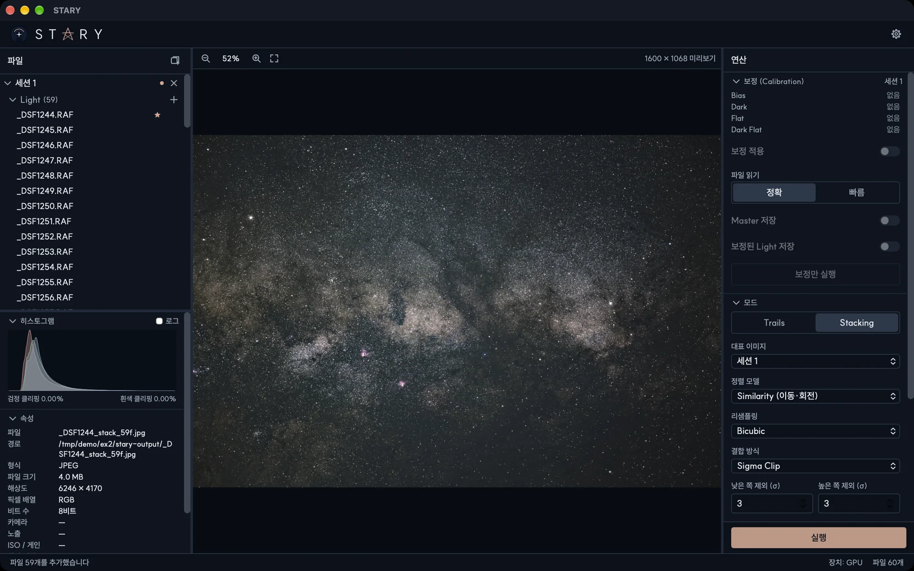

# 딥스카이 스태킹

모드 섹션에서 **Stacking**을 선택하면 딥스카이 이미지를 만듭니다. STARY가 모든 프레임의 별을 찾아 대표
이미지에 정렬하고, 같은 밝기로 맞춘 뒤 이상값을 제거하며 합칩니다. [처리 원리](../principles/alignment.md)를
참고하세요.

## 옵션

| 옵션 | 동작 |
|---|---|
| **대표 이미지** | 대표 이미지가 정렬 기준이 되는 세션. 결과가 이 세션의 크기를 따르고 이 세션의 하늘 마스크와 지면을 씁니다. 기본은 활성 세션입니다. |
| **정렬 모델** | *Similarity*(이동·회전, 기본), *Affine*, *Homography*. 왜곡이 있는 렌즈나 매우 넓은 화각에서 씁니다. |
| **리샘플링** | 프레임을 기준에 맞춰 옮기는 방식. *Bilinear*, *Bicubic*(기본), *Lanczos-3*(가장 선명) |
| **결합 방식** | *평균*은 모두 씁니다. *Sigma Clip*은 평균에서 먼 값을 제외합니다. *낮은 쪽 제외 (σ)*와 *높은 쪽 제외 (σ)*가 한계(기본 3과 3)입니다. |
| **HDR 합성** | 아래를 참고하세요. 세션에 노출이 둘 이상 있을 때만 켤 수 있습니다. |
| **불량 프레임 제외** | 세션의 나머지보다 훨씬 나쁜 프레임(구름, 안개, 흐림, 별이 끌림, 별이 너무 적음, 잡음이 큼)을 뺍니다. **제외** 표시가 붙습니다. |
| **지면 마스킹** | [지면 마스킹](ground-masking.md)을 참고하세요. |
| **디모자이킹 품질** | *빠름* 또는 *높음* |

**실행**을 누르세요. 결과 이름은 `DSCF2570_stack_37f.tif`처럼 만들어집니다. 상태 바에 몇 장이 스택되었는지,
몇 장이 정렬에 실패했는지, 몇 장이 품질 때문에 제외되었는지가 표시됩니다.

## 여러 세션 { #several-sessions }

Light가 있는 모든 세션이 **함께** 스택됩니다. 그래서 여러 밤의 촬영분을 합칠 수 있습니다. 각 세션은 자기 Dark,
Flat, Bias로 보정되고, 모든 프레임이 **대표 이미지**에서 고른 세션의 대표 이미지에 정렬됩니다.

- 기준 세션과 크기나 화소 배열이 다른 세션은 포함되지 않습니다.
- 밤마다 하늘 밝기가 다르므로 불량 프레임은 세션 안에서 따로 판정합니다.
- 마스크와 지면(지면 따로 적분을 쓸 때)은 기준 세션의 것만 씁니다.
- 노출이 달라도 됩니다. 각 프레임이 기준의 밝기에 맞춰지지만 가중치는 모두 같습니다.

## HDR 합성 { #hdr }

밝은 별이나 성운 중심은 장노출에서 포화됩니다. 단노출도 같이 찍었다면 **HDR 합성**이 노출별로 따로 스택하고,
장노출의 포화된 부분을 단노출 데이터로 바꿉니다.

1. 노출마다 **별도의 세션**에 넣으세요(각 세션은 한 가지 노출과 ISO의 프레임만 가집니다).
2. **HDR 합성**을 켭니다. 세션들에 노출이 둘 이상 있을 때만 켤 수 있습니다.
3. 실행하세요. 결과는 선형이고 가장 긴 노출의 밝기에 맞춰지므로, 밝은 부분은 1.0을 넘는 값이 될 수 있습니다.
   값을 보존하려면 32비트 float TIFF(기본)로 저장하세요. 8비트와 16비트 파일은 범위에 맞추려면 밝기
   옵션(*감마*나 *자동 스트레치*)이 필요합니다.

!!! warning "실험적"
    HDR 합성은 합성 데이터로 확인했습니다. HDR 합성을 켜면 *지면 따로 적분*은 쓰이지 않습니다.
