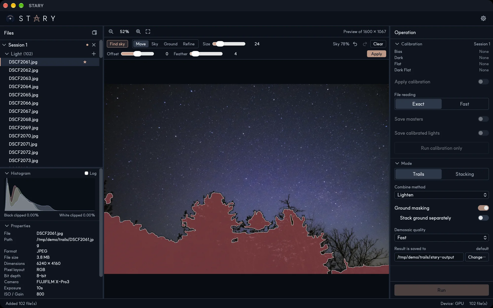

# Ground masking

A sky mask tells STARY where the sky is and where the landscape is. It is used to align on the stars only,
and to treat the ground apart from the sky.

## Making a mask

1. Turn on **Ground masking** in the Mode section.
2. Select the **representative image** of the session (the file with the star). The mask tools appear
   above the picture.
3. Press **Find sky**. The ground is shown in red and **Sky 78%** tells how much of the picture is sky.
4. Correct it if needed, adjust **Offset** and **Feather**, and press **Apply**.

**Run** stays disabled until the mask is applied.

## The tools

| Tool | Use |
|---|---|
| **Move** | Pan and zoom the picture. |
| **Sky**, **Ground** | Paint sky or ground with a brush. Before applying, strokes guide the detection; after applying, they paint the mask directly. **Size** sets the brush and **Hardness** its edge: soft edges blend the sky and ground results smoothly. |
| **Refine** | Draw along an edge to sharpen the outline locally (before applying). |
| **Offset** | Grows or shrinks the ground (before applying). |
| **Feather** | Softens the boundary (before applying). |
| **Undo**, **Redo**, **Clear** | Step back and forward, or remove the mask. |

Finding the sky again erases the mask made so far, and STARY asks before doing it.

## What the mask does

- **Stacking**: stars are matched only inside the sky, so a landscape that does not move does not confuse
  the alignment. If the sky holds fewer than 10 stars, STARY warns you before running.
- **Stack ground separately**: the ground is combined from the frames **without moving them**, and blended
  under the sky result through the mask. This keeps the landscape sharp instead of smearing it.
  In Trails the ground is averaged; with **HDR merge** on it is not used.

Masks belong to a session and are made at preview resolution. The mask follows the **representative
image**: if you change it, the mask stays, so check it when the framing differs.
