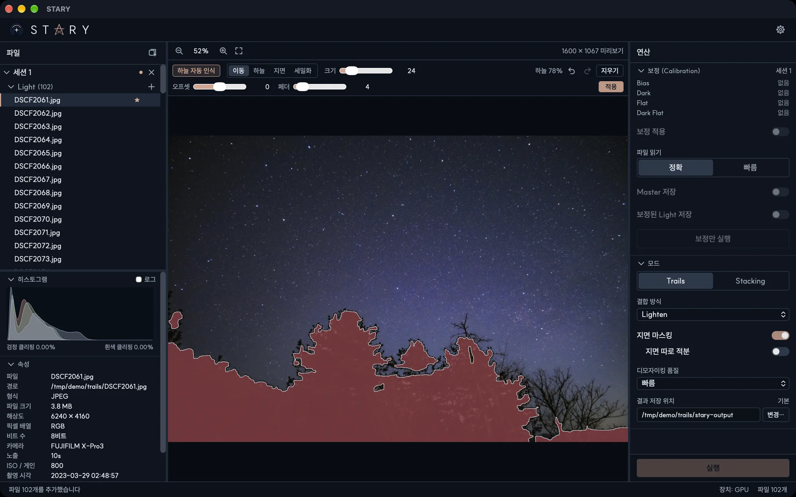

# 지면 마스킹

하늘 마스크는 STARY에게 어디가 하늘이고 어디가 풍경인지 알려 줍니다. 별만 보고 정렬하는 데 쓰이고, 지면을
하늘과 따로 처리하는 데에도 쓰입니다.

## 마스크 만들기

1. 모드 섹션에서 **지면 마스킹**을 켭니다.
2. 세션의 **대표 이미지**(별 표시가 붙은 파일)를 선택합니다. 그림 위에 마스크 도구가 나타납니다.
3. **하늘 자동 인식**을 누릅니다. 지면은 빨간색으로 표시되고 **하늘 78%**처럼 하늘 비율이 나옵니다.
4. 필요하면 고치고 **오프셋**과 **페더**를 조절한 뒤 **적용**을 누릅니다.

마스크를 적용하기 전에는 **실행**이 비활성화됩니다.

## 도구

| 도구 | 용도 |
|---|---|
| **이동** | 그림을 이동하고 확대합니다. |
| **하늘**, **지면** | 브러시로 하늘이나 지면을 칠합니다. 적용 전에는 칠한 획이 인식을 안내하고, 적용 후에는 마스크를 직접 칠합니다. **크기**가 브러시 크기이고 **경도**가 가장자리입니다. 부드러운 가장자리는 하늘과 지면 결과를 자연스럽게 섞습니다. |
| **세밀화** | 경계를 따라 그리면 윤곽을 그 부근에서 다듬습니다(적용 전). |
| **오프셋** | 지면을 키우거나 줄입니다(적용 전). |
| **페더** | 경계를 부드럽게 합니다(적용 전). |
| **실행 취소**, **다시 실행**, **지우기** | 되돌리기와 다시 하기, 마스크 삭제 |

하늘을 다시 인식하면 만든 마스크가 지워지므로 먼저 확인을 묻습니다.

## 마스크가 하는 일

- **Stacking**: 별을 하늘 영역에서만 맞추므로 움직이지 않는 풍경이 정렬을 방해하지 않습니다. 하늘에 별이
  10개 미만이면 실행 전에 경고합니다.
- **지면 따로 적분**: 지면은 프레임을 **옮기지 않고** 합치고, 마스크를 통해 하늘 결과 아래에 섞습니다. 풍경이
  번지지 않고 선명하게 남습니다. Trails에서는 지면을 평균으로 합치며, **HDR 합성**을 켜면 쓰이지 않습니다.

마스크는 세션에 속하고 미리보기 해상도로 만들어집니다. 마스크는 **대표 이미지**를 따릅니다. 대표 이미지를
바꿔도 마스크는 그대로 남으므로, 구도가 다르면 다시 확인하세요.
