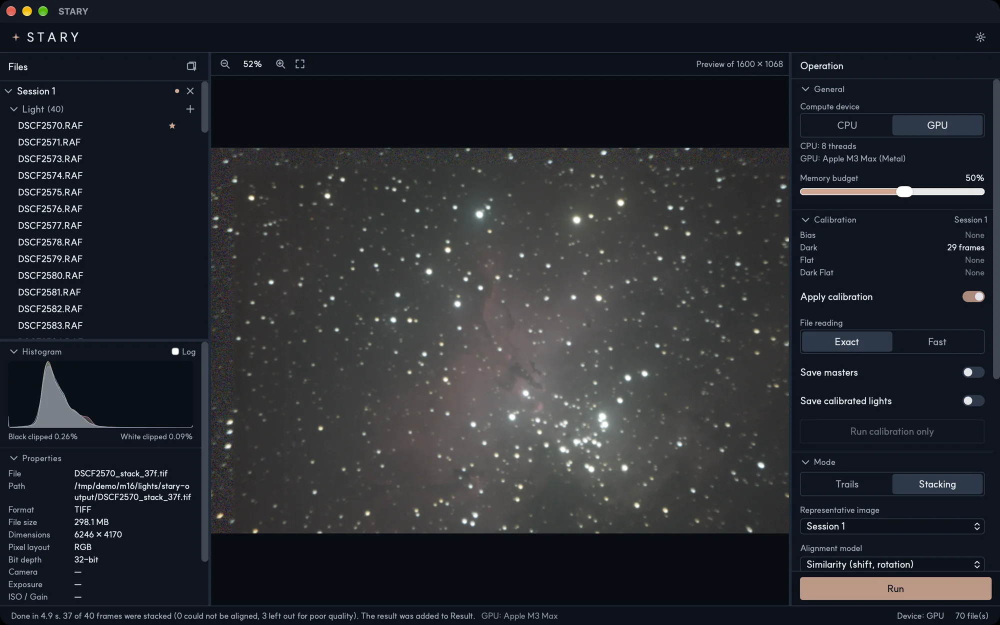

# The interface

The window has three areas and a status bar.

## Files panel (left)

- **Sessions** hold your frames, grouped by role: **Light**, **Dark**, **Flat**, **Dark Flat** and **Bias**.
  See [Files and sessions](files.md).
- **Result** lists the images STARY made. Click one to see it; right-click it for **Save as…**.
- Below the list, the **Histogram** and **Properties** panels describe the selected file: format,
  size, bit depth, camera, exposure and ISO.

## Viewer (center)

Shows the selected file as a preview (the label at the top right gives the preview size, for example
*Preview of 1600 × 1068*). Zoom with the buttons or the scroll wheel, drag to move, and use the fit button to
see the whole picture. When ground masking is on and the representative image is selected, the
[mask tools](ground-masking.md) appear above the picture.

## Operation panel (right)

| Section | What it holds |
|---|---|
| **Calibration** | The calibration frames of the session, *Apply calibration*, file reading, and options to save masters and calibrated lights. See [Calibration](calibration.md). |
| **Mode** | **Trails** or **Stacking** and the options of each. See [Star trails](star-trails.md) and [Deep-sky stacking](deep-sky.md). |
| **Run** | Starts the job. |

## Menu bar and top bar

The **Help** menu of the menu bar (at the top of the window on Windows, at the top of the screen on macOS) has **About STARY** (version, developer, links and license), **Report an issue**, which opens a new issue on GitHub with your version and system filled in, and **Documentation**, which opens this manual. The settings button at the top right of the window opens the settings: language, compute device (CPU or GPU), memory budget and updates. See [Settings](settings.md).

## Status bar

Shows what STARY is doing (looking for files, adding files, the stage and progress of a job with a
**Cancel** button), the outcome of the last job, the device in use and the number of files.

!!! note "While a job runs"
    The Operation panel, the file list and the mask tools are locked until the job ends, so that
    nothing changes under a running job. Viewing and selecting files still works.
