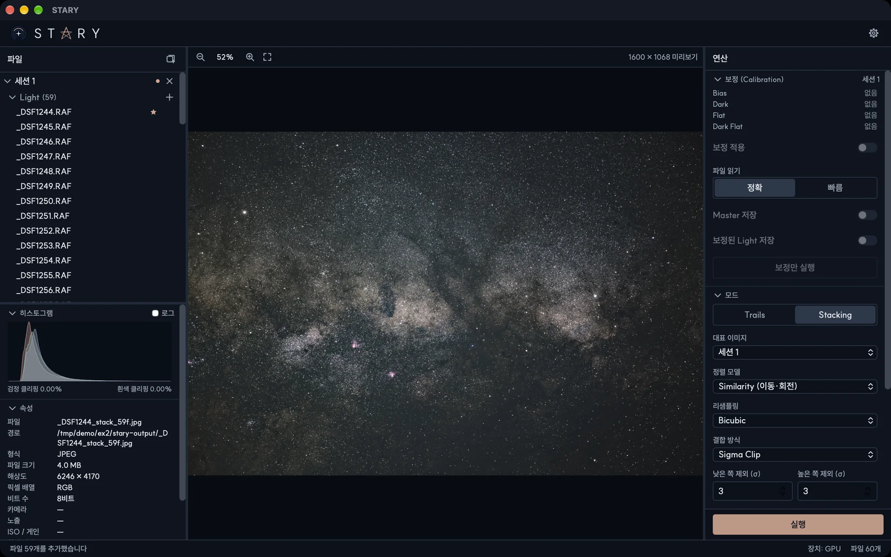

# 화면 구성

창은 세 영역과 상태 바로 이루어집니다.

## 파일 패널 (왼쪽)

- **세션**은 프레임을 역할별로 묶어 둡니다. 역할은 **Light**, **Dark**, **Flat**, **Dark Flat**, **Bias**입니다.
  [파일과 세션](files.md)을 참고하세요.
- **결과**에는 STARY가 만든 이미지가 나옵니다. 클릭하면 볼 수 있고, 우클릭하면 **다른 이름으로 저장…**이
  나옵니다.
- 목록 아래의 **히스토그램**과 **속성** 패널이 선택한 파일의 형식, 크기, 비트 수, 카메라, 노출, ISO를
  보여 줍니다.

## 뷰어 (가운데)

선택한 파일의 미리보기를 보여 줍니다(오른쪽 위 문구가 미리보기 크기, 예: *1600 × 1068 미리보기*). 버튼이나
스크롤로 확대·축소하고, 끌어서 이동하며, 맞춤 버튼으로 전체를 봅니다. 지면 마스킹을 켜고 대표 이미지를 선택하면
그림 위에 [마스크 도구](ground-masking.md)가 나타납니다.

## 연산 패널 (오른쪽)

| 섹션 | 내용 |
|---|---|
| **보정 (Calibration)** | 세션의 보정 프레임, *보정 적용*, 파일 읽기, Master와 보정된 Light 저장 옵션. [보정](calibration.md)을 참고하세요. |
| **모드** | **Trails** 또는 **Stacking**과 각 모드의 옵션. [별 궤적](star-trails.md), [딥스카이 스태킹](deep-sky.md)을 참고하세요. |
| **실행** | 작업을 시작합니다. |

## 메뉴 막대와 상단 막대

메뉴 막대(Windows에서는 창 위쪽, macOS에서는 화면 위쪽)의 **도움말** 메뉴에는 **STARY 정보**(버전, 개발자, 링크, 라이선스), **문제 보고**, **문서**가 있습니다. 문제 보고는 버전과 시스템 정보가 미리 채워진 새 이슈 작성 화면을 GitHub에서 열고, 문서는 이 매뉴얼을 엽니다. 창 오른쪽 위의 설정 버튼은 설정(언어, 연산 장치(CPU 또는 GPU), 메모리 예산, 업데이트)을 엽니다. [설정](settings.md)을 참고하세요.

## 상태 바

STARY가 하고 있는 일(파일 찾는 중, 파일 추가 중, 작업의 단계와 진행률과 **취소** 버튼), 마지막 작업의 결과,
사용 중인 장치, 파일 수를 보여 줍니다.

!!! note "작업이 실행되는 동안"
    실행 중인 작업 아래에서 아무것도 바뀌지 않도록 연산 패널, 파일 목록, 마스크 도구가 작업이 끝날 때까지
    잠깁니다. 파일을 보고 선택하는 것은 가능합니다.
