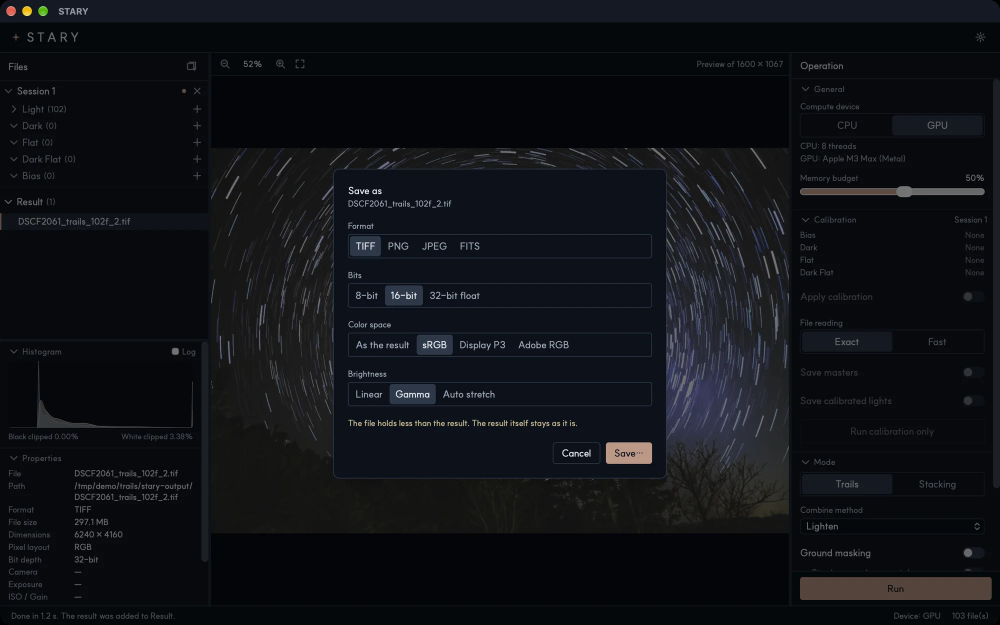

# Saving results

## Automatic save

When a job finishes, STARY saves the result by itself as a **32-bit float TIFF** in a `stary-output` folder
next to your first Light file. This keeps everything the stack contains. You can change the folder with
**Result is saved to → Change…**. Existing files are never overwritten; a number is added to the name
(`..._2.tif`).

The result is **linear**: the values are as the sensor recorded them, which looks dark on a screen. STARY
stretches it for display only. The file carries a color profile (for camera RAW input a profile named
*STARY camera RGB linear*), so editing programs read the colors correctly.

## Save as…

Right-click a result in the Result list and choose **Save as…**.

| Option | Choices |
|---|---|
| **Format** | TIFF, PNG, JPEG, FITS |
| **Bits** | 8-bit, 16-bit, 32-bit float |
| **Color space** | *As the result*, sRGB, Display P3, Adobe RGB. The profile is embedded in the file. |
| **Brightness** | *Linear* (as it is), *Gamma* (the display curve of the color space) or *Auto stretch* (lifts faint detail) |
| **Quality** | For JPEG |

Press **Save…** and choose a file name and place. A note appears when the file holds less than the result
(for example 8-bit). The result itself is never changed.

!!! tip "Which settings?"
    - For editing in Photoshop, GIMP or Siril: keep the automatic **32-bit TIFF**, or save **16-bit TIFF**
      with *Linear* brightness.
    - For sharing: **JPEG** or **PNG**, **sRGB**, **Auto stretch** or **Gamma**.
    - For other astronomy software: **FITS** (saved as linear 32-bit float).
