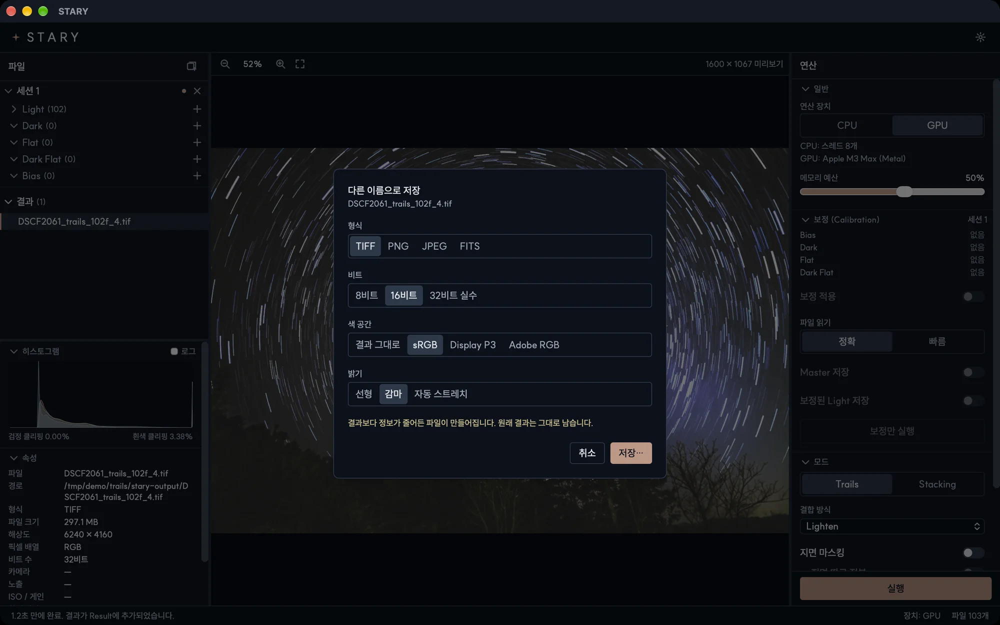

# 결과 저장

## 자동 저장

작업이 끝나면 STARY가 결과를 첫 번째 Light 파일 옆의 `stary-output` 폴더에 **32비트 float TIFF**로 스스로
저장합니다. 스택이 가진 정보를 모두 보존합니다. **결과 저장 위치 → 변경…**으로 폴더를 바꿀 수 있습니다. 기존
파일은 덮어쓰지 않고 이름에 번호가 붙습니다(`..._2.tif`).

결과는 **선형**입니다. 센서가 기록한 값 그대로라서 화면에서는 어둡게 보입니다. STARY는 표시할 때만 늘려서
보여 줍니다. 파일에는 색 프로필이 들어 있어서(카메라 RAW 입력이면 *STARY camera RGB linear*라는 프로필) 편집
프로그램이 색을 올바르게 읽습니다.

## 다른 이름으로 저장…

결과 목록에서 결과를 우클릭하고 **다른 이름으로 저장…**을 선택하세요.

| 옵션 | 선택지 |
|---|---|
| **형식** | TIFF, PNG, JPEG, FITS |
| **비트** | 8비트, 16비트, 32비트 실수 |
| **색 공간** | *결과 그대로*, sRGB, Display P3, Adobe RGB. 프로필이 파일에 들어갑니다. |
| **밝기** | *선형*(그대로), *감마*(색 공간의 표시 곡선), *자동 스트레치*(희미한 디테일을 끌어올림) |
| **품질** | JPEG용 |

**저장…**을 누르고 파일 이름과 위치를 정하세요. 파일이 결과보다 정보가 줄어들면(예: 8비트) 안내가 나옵니다.
결과 자체는 바뀌지 않습니다.

!!! tip "어떤 설정이 좋을까요?"
    - Photoshop, GIMP, Siril에서 편집할 때: 자동 저장된 **32비트 TIFF**를 쓰거나, 밝기 *선형*의 **16비트
      TIFF**로 저장하세요.
    - 공유할 때: **JPEG** 또는 **PNG**, **sRGB**, **자동 스트레치**나 **감마**
    - 다른 천문 소프트웨어: **FITS**(선형 32비트 float로 저장됩니다)
