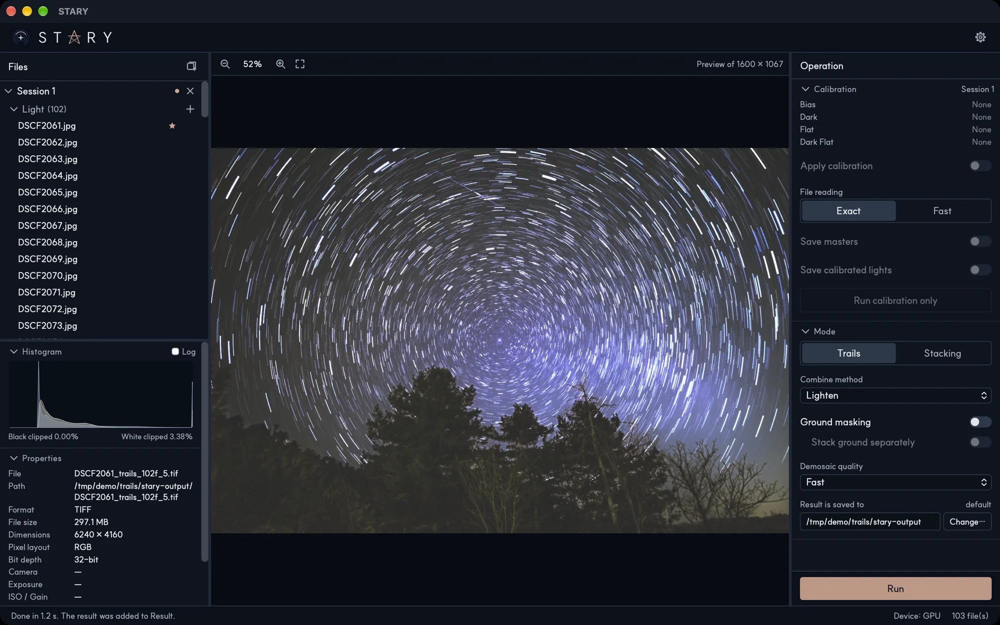

# Star trails

Choose **Trails** in the Mode section to make a star-trail image. Frames are **not aligned**: the stars
move from frame to frame, and keeping the brightest value of every pixel draws their paths.

## Combine method

| Method | Result |
|---|---|
| **Lighten** | Classic trails. Every pixel keeps its brightest value over all frames. |
| **Comet** | A star with a fading tail, like a comet: each frame fades out over a number of frames. *Tail length* sets how many frames the tail lasts; *Reverse order* makes the tail run the other way. |
| **Gap Filling** | Joins the dotted trails that long intervals between frames leave, by filling in the missing positions. Needs at least two frames. Things fixed to the ground are smeared too, so combine it with [ground masking](ground-masking.md). |

## Other options

- **Ground masking** keeps the landscape sharp. With *Stack ground separately* the ground is averaged from
  all frames instead of being lightened, which lowers its noise.
- **Demosaic quality** — *Fast* or *High* (slower). See [Settings](settings.md).
- **Result is saved to** — the folder of the result (`stary-output` next to your first Light).

Press **Run**. The result is named like `DSC_0001_trails_102f.tif` (first file, mode, number of frames).

!!! tip "Many frames, few seconds"
    Trails are combined on the raw sensor data and the picture is demosaiced once at the end, so even hundreds of
    frames take only seconds. 102 frames took 1.2 seconds on an Apple M3 Max.
