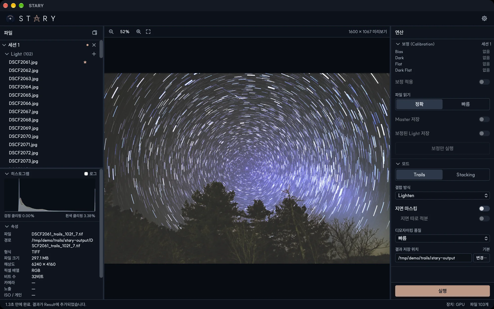

# 별 궤적

모드 섹션에서 **Trails**를 선택하면 별 궤적 이미지를 만듭니다. 프레임을 **정렬하지 않습니다**. 별이 프레임마다
움직이므로 화소마다 가장 밝은 값을 남기면 별의 이동 경로가 그려집니다.

## 결합 방식

| 방식 | 결과 |
|---|---|
| **Lighten** | 일반적인 궤적. 모든 프레임에서 화소마다 가장 밝은 값을 남깁니다. |
| **Comet** | 혜성처럼 꼬리가 점점 옅어지는 별. 각 프레임이 일정한 프레임 수 동안 옅어집니다. *꼬리 길이*가 꼬리가 유지되는 프레임 수이고, *역순*은 꼬리 방향을 뒤집습니다. |
| **Gap Filling** | 프레임 사이 간격이 길어 점선처럼 끊긴 궤적을 빠진 위치를 채워서 이어 줍니다. 프레임이 2장 이상 필요합니다. 지면에 고정된 것도 함께 번지므로 [지면 마스킹](ground-masking.md)과 함께 쓰세요. |

## 다른 옵션

- **지면 마스킹**은 풍경을 선명하게 유지합니다. *지면 따로 적분*을 켜면 지면을 가장 밝은 값이 아니라 모든
  프레임의 평균으로 만들어서 잡음이 줄어듭니다.
- **디모자이킹 품질** — *빠름* 또는 *높음*(느림). [설정](settings.md)을 참고하세요.
- **결과 저장 위치** — 결과가 저장되는 폴더(첫 Light 옆의 `stary-output`)

**실행**을 누르세요. 결과 이름은 `DSC_0001_trails_102f.tif`처럼 첫 파일, 모드, 프레임 수로 만들어집니다.

!!! tip "수백 장도 몇 초"
    궤적은 센서 원본 데이터 상태에서 합치고 마지막에 한 번만 디모자이킹하므로, 수백 장도 몇 초면 끝납니다.
    Apple M3 Max에서 102장이 1.2초 걸렸습니다.
