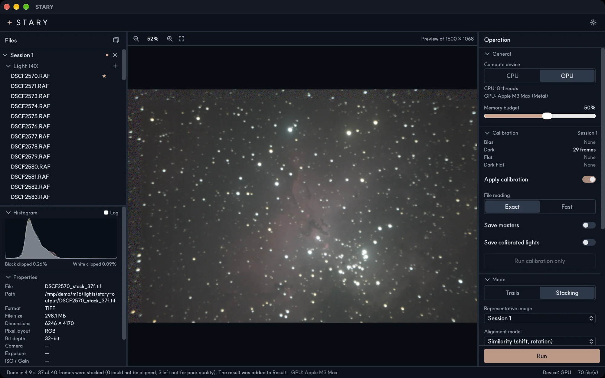

# STARY { .stary-title }

*Make your own starry sky story.*

STARY is a desktop application that calibrates, aligns and stacks night-sky photographs. It makes
deep-sky stacks with noise rejection and star-trail images, on macOS (Apple silicon) and Windows.

## Where to start

- **[Install](install.md)** — download STARY and open it for the first time.
- **[Quick start](quickstart.md)** — make your first image in a few minutes.
- **[User guide](guide/interface.md)** — every panel and option, one by one.
- **[How it works](principles/index.md)** — the ideas behind calibration, alignment and stacking.

## Two modes

| Mode | Use it for | What happens |
|---|---|---|
| **Trails** | Star-trail images | Frames are not aligned; the brightest value of every pixel is kept, so each star draws a line. Variants: Comet and Gap Filling. |
| **Stacking** | Deep-sky images | The stars of all frames are aligned and the frames are averaged with outlier rejection, which lowers noise and reveals faint detail. |

!!! note "Pre-release"
    STARY is young. Some features, such as HDR merge and stacking several sessions, have been
    tested on synthetic data and a few real sets only. See [Troubleshooting](reference/troubleshooting.md)
    and report anything odd on the [issue tracker](https://github.com/Domiki/STARY/issues).
