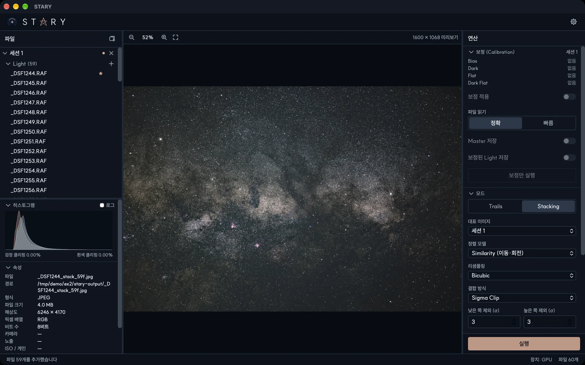

# STARY { .stary-title }

*Make your own starry sky story.*

STARY는 밤하늘 사진을 보정하고 정렬해서 합치는 데스크톱 프로그램입니다. 잡음을 줄인 딥스카이 이미지와
별 궤적 이미지를 만들 수 있고, macOS(Apple silicon)와 Windows에서 동작합니다.

## 어디서부터 볼까요

- **[설치](install.md)** — 내려받고 처음 실행하는 방법
- **[빠른 시작](quickstart.md)** — 몇 분 안에 첫 이미지 만들기
- **[사용자 가이드](guide/interface.md)** — 각 패널과 옵션을 하나씩 설명
- **[처리 원리](principles/index.md)** — 보정, 정렬, 스태킹의 원리

## 두 가지 모드

| 모드 | 용도 | 동작 |
|---|---|---|
| **Trails** | 별 궤적 이미지 | 프레임을 정렬하지 않고 화소마다 가장 밝은 값을 남겨서 별이 선을 그립니다. 변형으로 Comet과 Gap Filling이 있습니다. |
| **Stacking** | 딥스카이 이미지 | 모든 프레임의 별을 맞춰 겹치고 이상값을 제거하며 평균해서 잡음을 줄이고 희미한 디테일을 드러냅니다. |

!!! note "프리릴리스"
    STARY는 아직 초기 버전입니다. HDR 합성이나 여러 세션 스택 같은 일부 기능은 합성 데이터와 소수의 실제
    촬영분으로만 확인했습니다. [문제 해결](reference/troubleshooting.md)을 참고하시고, 이상한 점은
    [이슈 트래커](https://github.com/Domiki/STARY/issues)에 알려 주세요.
