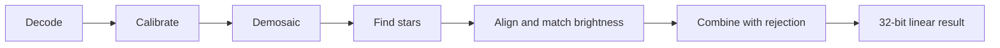

# How it works

This section explains what STARY does to your photographs, so that you can judge the results and choose
the options with confidence.

## The path of a frame

1. **Decode** — the file is read; camera RAW gives the raw sensor values.
2. **Calibrate** — dark and flat frames correct the sensor values (still raw, before color).
3. **Demosaic** — the one-color-per-pixel sensor pattern becomes a color picture.
4. **Find stars, align, match brightness** — in Stacking mode.
5. **Combine** — frames are merged with outlier rejection (Stacking) or by keeping the brightest value (Trails).
6. **Result** — a 32-bit float picture that is **linear**: no tone curve has been applied. The curve is
   chosen when you save.

## Principles in STARY

- **Work on linear data, in 32-bit float.** Nothing is rounded or stretched along the way, so faint
  signals are not lost.
- **Calibrate before demosaicing.** The faults of the sensor live in its raw values; correcting them first keeps
  them from spreading into the colors.
- **Memory does not grow with the number of frames.** Frames are processed one at a time and added to
  running totals, so a thousand frames need about as much memory as ten.

The following pages describe each step: [calibration](calibration.md), [alignment and
normalization](alignment.md), [outlier rejection](rejection.md), [star trails](trails.md) and
[HDR merge](hdr.md).
