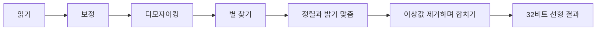

# 처리 원리

STARY가 사진에 어떤 처리를 하는지 설명합니다. 결과를 판단하고 옵션을 자신 있게 고르는 데 도움이 됩니다.

## 프레임이 거치는 길

1. **읽기** — 파일을 읽습니다. 카메라 RAW는 센서의 원본 값을 줍니다.
2. **보정** — Dark와 Flat 프레임으로 센서 값을 바로잡습니다(아직 원본 상태, 색이 만들어지기 전).
3. **디모자이킹** — 화소마다 한 가지 색만 가진 센서 배열을 컬러 이미지로 바꿉니다.
4. **별 찾기, 정렬, 밝기 맞춤** — Stacking 모드에서 합니다.
5. **합치기** — 이상값을 제거하며 합치거나(Stacking) 가장 밝은 값을 남깁니다(Trails).
6. **결과** — **선형**인 32비트 float 이미지입니다. 톤 곡선은 적용되지 않았고, 저장할 때 고릅니다.

## STARY의 원칙

- **선형 데이터를 32비트 float로 다룹니다.** 중간에 반올림이나 늘리기가 없어서 희미한 신호가 사라지지 않습니다.
- **디모자이킹 전에 보정합니다.** 센서의 결함은 원본 값에 있으므로 먼저 바로잡아야 색으로 번지지 않습니다.
- **메모리가 프레임 수에 따라 늘지 않습니다.** 프레임을 한 장씩 처리해 누적 합계에 더하기 때문에, 천 장도
  열 장과 비슷한 메모리면 됩니다.

다음 페이지들이 각 단계를 설명합니다. [보정](calibration.md), [정렬과 정규화](alignment.md),
[이상값 제거](rejection.md), [별 궤적](trails.md), [HDR 합성](hdr.md)

