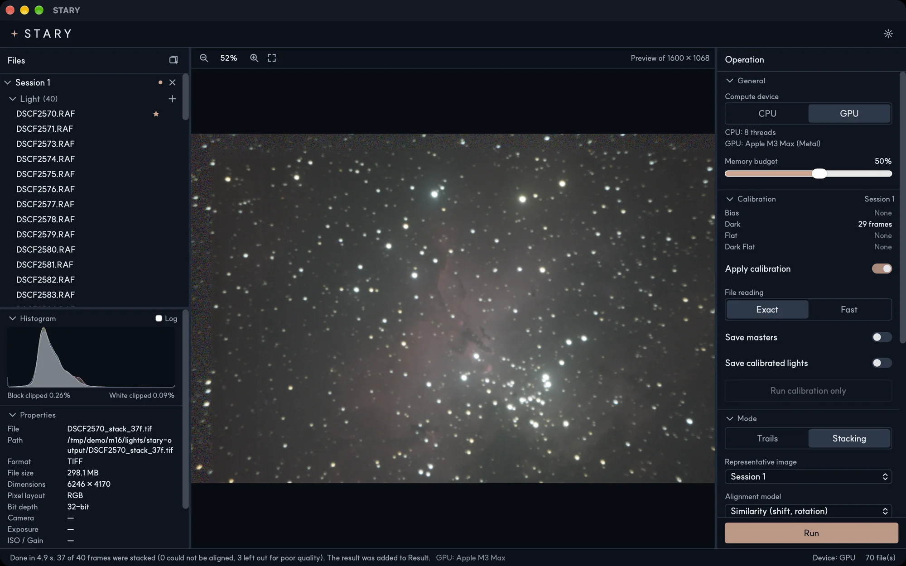

# Quick start

This walkthrough makes a deep-sky stack. Star trails work the same way; only the mode differs.

## 1. Add your frames

Drag your **Light** frames onto the *Light* row of *Session 1* in the Files panel, or click the **+**
next to it. If you have calibration frames, add them to **Dark**, **Flat**, **Dark Flat** and **Bias** in
the same way. STARY asks you to confirm before adding.

## 2. Choose a mode

In the **Mode** section of the Operation panel choose **Stacking** (deep sky) or **Trails** (star trails).
The defaults are good for most sets.

## 3. Run

Press **Run**. The progress and the time taken appear in the status bar. When it finishes, the result is
added to the **Result** list and shown in the viewer.

## 4. Save

The result is already saved as a 32-bit float TIFF in a `stary-output` folder next to your first Light file.
Right-click it in the Result list and choose **Save as…** to export PNG, JPEG, FITS or another TIFF in the bit
depth and color space you need.

!!! tip "A dark result?"
    The saved file is linear, which looks dark on a screen. STARY stretches it for display. When you export
    for the web or print, choose *Gamma* or *Auto stretch* as the brightness. See [Saving results](guide/saving.md).
