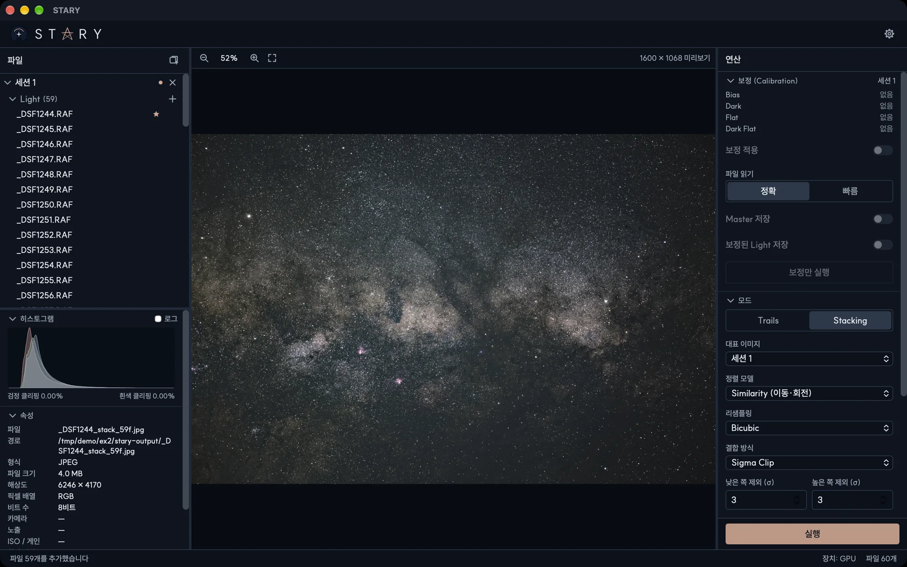

# 빠른 시작

딥스카이 스택을 만드는 과정입니다. 별 궤적도 같은 방식이고 모드만 다릅니다.

## 1. 프레임 추가

파일 패널의 *세션 1* 안 *Light* 행에 **Light** 프레임을 끌어 놓거나 옆의 **+** 버튼을 누르세요. 보정 프레임이
있다면 **Dark**, **Flat**, **Dark Flat**, **Bias**에도 같은 방법으로 추가합니다. 추가하기 전에 확인 창이 뜹니다.

## 2. 모드 선택

연산 패널의 **모드** 섹션에서 **Stacking**(딥스카이) 또는 **Trails**(별 궤적)를 고릅니다. 기본값은 대부분의
촬영분에 무난합니다.

## 3. 실행

**실행**을 누르세요. 진행 상황과 걸린 시간이 하단 상태 바에 나옵니다. 끝나면 결과가 **결과** 목록에 추가되고
뷰어에 표시됩니다.

## 4. 저장

결과는 첫 번째 Light 파일 옆의 `stary-output` 폴더에 32비트 float TIFF로 이미 저장되어 있습니다. 결과 목록에서
우클릭해 **다른 이름으로 저장…**을 선택하면 PNG, JPEG, FITS, 다른 비트 수의 TIFF를 원하는 색 공간으로 내보낼
수 있습니다.

!!! tip "결과가 어둡게 보이나요?"
    저장된 파일은 선형이라 화면에서는 어둡게 보입니다. STARY는 표시할 때 늘려서 보여 줍니다. 웹이나 인쇄용으로
    내보낼 때는 밝기를 *감마* 또는 *자동 스트레치*로 선택하세요. [결과 저장](guide/saving.md)을 참고하세요.
